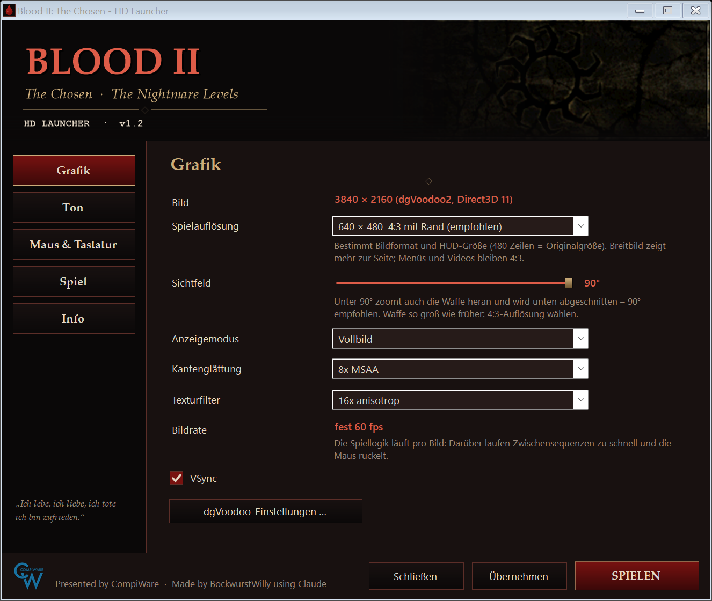

# Blood II: The Chosen – HD Patch & Launcher

Inoffizieller HD-Patch mit eigenem Launcher für **Blood II: The Chosen + The Nightmare Levels (GOG)** unter Windows 10/11.
Ein Setup statt eines Abends mit Wiki, Downloads und Konfigurationsdateien. Die Deinstallation stellt den Spielordner byte-genau wieder her.

*Unofficial HD patch and launcher for the GOG release of Blood II: The Chosen. English summary below.*



## Was der Patch macht

| Bereich | Lösung |
|---|---|
| Grafik | dgVoodoo2 (Direct3D 6 → 11): 3D-Bild in Monitorauflösung bis 4K, bis 8x MSAA, anisotrope Filterung, randloses Vollbild oder Fenster |
| Bildrate | fest 60 fps – die Spiellogik läuft pro Bild, darüber laufen Zwischensequenzen zu schnell und die Maus ruckelt |
| Ton | DSOAL + OpenAL Soft: DirectSound mit **EAX** auf heutiger Hardware, optional Kopfhörer-3D (HRTF) |
| EAX | Der 3D-Provider wird **über den Namen** gewählt (`++3dsoundprovider 7 ++3dsoundprovidername …`). Über die Provider-Nummer fällt das Spiel still auf „kein 3D-Sound“ zurück. |
| Maus | dinputto8: behebt den kaputten Mausblick bei Mäusen über 125 Hz |
| Steuerung | Tastenbelegung, Mausempfindlichkeit, Maus umkehren im Launcher; Vorlagen „Modern (WASD)“ und „Original (1998)“ |
| Breitbild | eigener Hor+-Fix im Speicher (keine fremden Dateien): mehr Sicht zur Seite, auch in Zwischensequenzen; Sichtfeld-Regler 70–90°; ab Werk 4:3 wie im Original |
| Vollbild | randloses Vollbild statt exklusivem Modus (sonst kleines verschobenes Fenster bzw. eingefrorenes Bild nach Alt+Enter) |
| Rechte | kein Admin-/XP-Modus mehr (GOG-Kompatibilitätseinträge ersetzt, bei der Deinstallation wiederhergestellt) |
| Spiel | The Nightmare Levels an/aus, Logo-Videos überspringen |

Ausführliche Beschreibung für Spieler: [README.txt](README.txt) (liegt auch dem Download bei).

## Installation (Spieler)

1. `Blood2HD_Setup.exe` aus den [Releases](../../releases) laden und starten – es findet das GOG-Spiel selbst.
2. Spielen über „Blood II - HD Launcher“ oder wie gewohnt über GOG Galaxy (der HD-Launcher ersetzt `BLOOD2.EXE`, das Original wird gesichert).
3. Entfernen über Windows „Apps & Features“.

Getestet mit der GOG-Version: Blood II 2.0 + Nightmares 1.0.233 (`Client.exe` SHA1 `D7D8138E837443740CF5C995B568ECD437F52B5F`).

## Selbst bauen

Voraussetzungen:

- Windows 10/11, Windows PowerShell 5.1
- Visual Studio 2019+ oder die **Build Tools** mit „.NET-Desktopbuildtools“ (für `csc.exe`/Roslyn, C# 7.3)
- .NET Framework 4.x (bei Windows dabei)

```powershell
powershell -ExecutionPolicy Bypass -File build.ps1
```

Ergebnis:

- `out\Blood2HD_Setup.exe` – ein einzelnes Setup, alles eingebettet (Launcher, Payload, Doku, Lizenzen)
- `out\release\Blood2HD_Patch_<Version>.zip` – Paket zum Hochladen (Setup, Liesmich, Lizenzen, SHA256)

Die Version steht in `src\common\Text.cs` (`Version.Text`) und in den beiden `AssemblyInfo.cs`.

## Testen

```powershell
# Installieren -> Update (Einstellungen bleiben) -> Deinstallieren -> Byte-Vergleich mit dem Ausgangszustand
powershell -ExecutionPolicy Bypass -File tests\e2e.ps1 -GameCopy "<Kopie eines unveränderten GOG-Spielordners>"
```

Spieltests (starten das Spiel, schicken Eingaben nur, solange das Spielfenster vorne ist):

- `tools\ingame.ps1 -Game <Ordner> -Out <Ordner> [-ViaLauncher] [-MouseTest]` – ins erste Level, bewegen, schießen, Screenshots, DSOAL-Log
- `tools\menushot.ps1` – Hauptmenü fotografieren, ohne Eingaben

Launcher-Schalter für Tests: `/cmdline=<Datei>`, `/snapshot=<Ordner>`, `/keys=modern|original`, `/launch[=<Logdatei>]`.
`BLOOD2HD_WORKAREA=1920x1032` täuscht einen kleineren Bildschirm vor (Verkleinerung des Launchers).

## Aufbau

```
src/common/     gemeinsam für Launcher und Setup: Spielerkennung, Einstellungen, autoexec.cfg, Texte (DE/EN), Theme
src/launcher/   BLOOD2.EXE – der HD-Launcher; GameStart.cs = Start + Breitbild-Sichtfeld
src/setup/      Blood2HD_Setup.exe – Installation, Update, Deinstallation
src/res/        Logos
payload/game/   Drittanbieter-Dateien, die ins Spielverzeichnis kommen (unverändert)
payload/licenses/  deren Lizenzen
tests/e2e.ps1   End-to-End-Test
tools/          Spieltests und Analyse-Helfer (xref.py, rezdll.py, milesenum.c)
docs/           Machbarkeitsstudie (Source Port), Screenshots
```

Spieldateien gehören **nicht** ins Repository (`testgame/`, `reference/` stehen in `.gitignore`).

## Technische Notizen

- **Breitbild-Sichtfeld:** Der Launcher startet `Client.exe` angehalten und leitet die Kopie des Kamera-Sichtfelds bei `0x40FBFD` auf 80 Bytes eigenen x87-Code im ungenutzten Ende von `.text` (`0x47E300`) um:
  `h' = 2·atan(tan(h/2)·k·(w/h)/(4/3))`, `v' = 2·atan(tan(v/2)·k)`, `k = tan(FOV/2)`. Nur wenn die Originalbytes passen; Ergebnis in `_HDPatch\launch.log`. Auf der Platte ändert sich nichts.
- **EAX:** Miles-Provider-Namen und der Fallback bei falscher Nummer sind in `PatchSettings.CommandLine()` beschrieben; Nachweis im DSOAL-Log (`DSOAL_LOGLEVEL=4`: `EAX10_ListenerProperties`).
- **Kompatibilität:** GOG setzt `WINXPSP2 DISABLETHEMES DISABLEDWM RUNASADMIN HIGHDPIAWARE`; der Patch setzt nur `~ HIGHDPIAWARE` für `Client.exe` und sichert die Originale in `_HDPatch_Backup\compat.txt`.

## Dank

- **dgVoodoo2** – Dege (Freeware)
- **DSOAL**, **OpenAL Soft** – Chris Robinson (LGPL)
- **dinputto8** – Elisha Riedlinger (zlib)
- **AlphaYellow** – [Widescreen Fixes](https://github.com/alphayellow1/AlphaYellowWidescreenFixes) (MIT): die Stelle des Kamera-Sichtfelds in `Client.exe`
- **PCGamingWiki**-Community – Hinweise zu Maus, Bildrate und EAX

Details und Versionen: [THIRD-PARTY.txt](THIRD-PARTY.txt).

## Lizenz

Eigener Code und Doku: [MIT](LICENSE). Drittanbieter-Dateien in `payload/` unter ihren eigenen Lizenzen. Die Logos in `src/res/` gehören ihren Inhabern.

Blood II: The Chosen © 1998 Monolith Productions. Inoffizielles Fanprojekt, enthält keine Spieldateien.

---

## English

Unofficial HD patch and launcher for the GOG release of *Blood II: The Chosen* + *The Nightmare Levels* on Windows 10/11: dgVoodoo2 (D3D11, up to 4K, MSAA), 60 fps cap, DSOAL + OpenAL Soft with working EAX (the provider has to be selected by name), dinputto8 mouse fix, key bindings in the launcher, optional Hor+ widescreen (own in-memory patch, no third-party files), borderless fullscreen, no admin/XP mode. One setup; uninstalling restores the game folder byte for byte.

Build: Visual Studio 2019+ or Build Tools (.NET desktop build tools), then `powershell -ExecutionPolicy Bypass -File build.ps1` → `out\Blood2HD_Setup.exe` and `out\release\*.zip`. Test: `tests\e2e.ps1 -GameCopy <pristine GOG copy>`.

Made by BockwurstWilly using Claude · Presented by CompiWare
