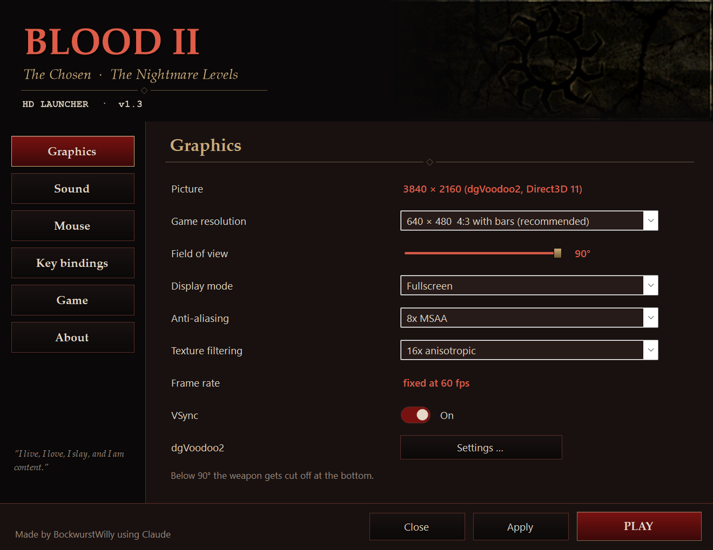

# Blood II: The Chosen – HD Patch & Launcher

Unofficial HD patch with its own launcher for **Blood II: The Chosen + The Nightmare Levels (GOG)** on Windows 10/11.
One setup instead of an evening with wikis, downloads and config files. Uninstalling restores the game folder byte for byte.

*Inoffizieller HD-Patch mit Launcher für die GOG-Version – deutsche Kurzfassung unten.*



## What it does

| Area | Solution |
|---|---|
| Graphics | dgVoodoo2 (Direct3D 6 → 11): 3D picture at monitor resolution up to 4K, up to 8x MSAA, anisotropic filtering, borderless fullscreen or window |
| Frame rate | locked to 60 fps – the game logic runs per frame; above that cutscenes run too fast and the mouse stutters |
| Sound | DSOAL + OpenAL Soft: DirectSound with **EAX** on today's hardware, optional headphone 3D (HRTF) |
| EAX | the 3D provider is chosen **by name** (`++3dsoundprovider 7 ++3dsoundprovidername …`). By provider number the game silently falls back to "no 3D sound" |
| Mouse | dinputto8: fixes the broken mouse look with mice above 125 Hz |
| Controls | key bindings, mouse sensitivity and invert mouse in the launcher; presets "Modern (WASD)" and "Original (1998)" |
| Widescreen | own Hor+ fix in memory (no third-party files): more view to the sides, also in cutscenes; field-of-view slider 70–90°; 4:3 by default as in the original |
| Fullscreen | borderless fullscreen instead of exclusive mode (otherwise a small shifted window or a frozen picture after Alt+Enter) |
| Rights | no more admin / XP mode (GOG's compatibility entries are replaced and restored on uninstall) |
| Game | The Nightmare Levels on/off, skip the logo videos |
| Language | launcher in English or German, follows Windows by default, switchable under Game |

Full player documentation (German and English): [README.txt](README.txt) – also included in the download.

## Installation

1. Download `Blood2HD_Patch_<version>.zip` from [Releases](../../releases), unzip it and run `Blood2HD_Setup.exe` – it finds the GOG game by itself.
2. Play via "Blood II - HD Launcher" or from GOG Galaxy as usual (the HD launcher replaces `BLOOD2.EXE`; the original is backed up).
3. Uninstall via Windows "Apps & Features".

Tested with the GOG release: Blood II 2.0 + Nightmares 1.0.233 (`Client.exe` SHA1 `D7D8138E837443740CF5C995B568ECD437F52B5F`).

## Building

Requirements:

- Windows 10/11, Windows PowerShell 5.1
- Visual Studio 2019+ or the **Build Tools** with ".NET desktop build tools" (for `csc.exe` / Roslyn, C# 7.3)
- .NET Framework 4.x (part of Windows)

```powershell
powershell -ExecutionPolicy Bypass -File build.ps1
```

Output:

- `out\Blood2HD_Setup.exe` – a single setup with everything embedded (launcher, payload, docs, licenses)
- `out\release\Blood2HD_Patch_<version>.zip` – the package for a release (setup, readme, licenses, SHA256)

The version lives in `src\common\Text.cs` (`Version.Text`) and both `AssemblyInfo.cs`.

## Testing

```powershell
# install -> update (settings kept) -> uninstall -> byte comparison with the starting state
powershell -ExecutionPolicy Bypass -File tests\e2e.ps1 -GameCopy "<copy of an untouched GOG game folder>"
```

In-game tests (they start the game and send input only while the game window is in front):

- `tools\ingame.ps1 -Game <folder> -Out <folder> [-ViaLauncher] [-MouseTest]` – into the first level, move, shoot, screenshots, DSOAL log
- `tools\menushot.ps1` – screenshot of the main menu, no input

Launcher switches for tests: `/cmdline=<file>`, `/snapshot=<folder>`, `/keys=modern|original`, `/launch[=<logfile>]`, `/lang=en|de`.
`BLOOD2HD_WORKAREA=1920x1032` fakes a smaller screen (launcher scaling).

## Layout

```
src/common/     shared by launcher and setup: game detection, settings, autoexec.cfg, texts (DE/EN), theme
src/launcher/   BLOOD2.EXE – the HD launcher; GameStart.cs = start + widescreen field of view
src/setup/      Blood2HD_Setup.exe – install, update, uninstall
src/res/        logos
payload/game/   third-party files that go into the game folder (unchanged)
payload/licenses/  their licenses
tests/e2e.ps1   end-to-end test
tools/          in-game tests
docs/screens/   launcher screenshots
```

Game files are **not** part of the repository (`testgame/` and `reference/` are in `.gitignore`).

## Technical notes

- **Widescreen field of view:** the launcher starts `Client.exe` suspended and redirects the copy of the camera's field of view at `0x40FBFD` to 80 bytes of own x87 code in the unused tail of `.text` (`0x47E300`):
  `h' = 2·atan(tan(h/2)·k·(w/h)/(4/3))`, `v' = 2·atan(tan(v/2)·k)`, `k = tan(FOV/2)`. Only when the original bytes match; result in `_HDPatch\launch.log`. Nothing changes on disk.
- **EAX:** the Miles provider names and the fallback for a wrong number are described in `PatchSettings.CommandLine()`; proof in the DSOAL log (`DSOAL_LOGLEVEL=4`: `EAX10_ListenerProperties`).
- **Compatibility:** GOG sets `WINXPSP2 DISABLETHEMES DISABLEDWM RUNASADMIN HIGHDPIAWARE`; the patch only sets `~ HIGHDPIAWARE` for `Client.exe` and keeps the originals in `_HDPatch_Backup\compat.txt`.

## Credits

- **dgVoodoo2** – Dege (freeware)
- **DSOAL**, **OpenAL Soft** – Chris Robinson (LGPL)
- **dinputto8** – Elisha Riedlinger (zlib)
- **AlphaYellow** – [Widescreen Fixes](https://github.com/alphayellow1/AlphaYellowWidescreenFixes) (MIT): the location of the camera field of view in `Client.exe`
- **PCGamingWiki** community – notes on mouse, frame rate and EAX

Details and versions: [THIRD-PARTY.txt](THIRD-PARTY.txt).

## License

© 2026 [BockwurstWilly](https://github.com/BockwurstWilly) – the patch's own code and docs are licensed under the
**[PolyForm Noncommercial License 1.0.0](LICENSE)**: you may use, share and change it for any non-commercial purpose,
as long as the `Required Notice` line (credit to BockwurstWilly with the link) stays with every copy.
Commercial use – selling, paid bundles, ad-financed download portals – only by arrangement: contact me via GitHub.

Third-party files in `payload/` keep their own licenses (see [THIRD-PARTY.txt](THIRD-PARTY.txt)). The logos in `src/res/` belong to their owners.

Blood II: The Chosen © 1998 Monolith Productions. Unofficial fan project; contains no game files.

---

## Deutsch

Inoffizieller HD-Patch mit eigenem Launcher für die GOG-Version von *Blood II: The Chosen* + *The Nightmare Levels* unter Windows 10/11: dgVoodoo2 (Direct3D 11, bis 4K, MSAA), 60 fps, DSOAL + OpenAL Soft mit funktionierendem EAX (der Provider muss über den Namen gewählt werden), Maus-Fix mit dinputto8, Tastenbelegung im Launcher, optionales Hor+-Breitbild (eigener Patch im Speicher), randloses Vollbild, kein Admin-/XP-Modus. Launcher auf Deutsch oder Englisch. Ein Setup; die Deinstallation stellt den Spielordner byte-genau wieder her. Ausführlich: [README.txt](README.txt).

Lizenz: PolyForm Noncommercial 1.0.0 – frei nutzen, weitergeben und verändern, aber nicht kommerziell; der Hinweis auf BockwurstWilly muss bleiben. Kommerzielle Nutzung nur nach Absprache.

Made by BockwurstWilly using Claude
